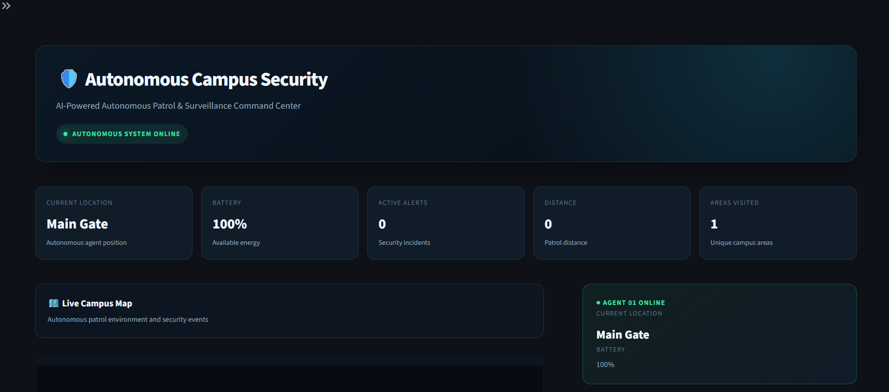
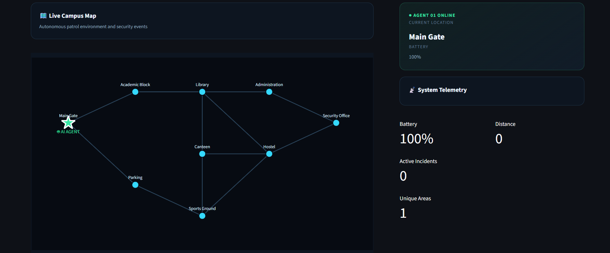
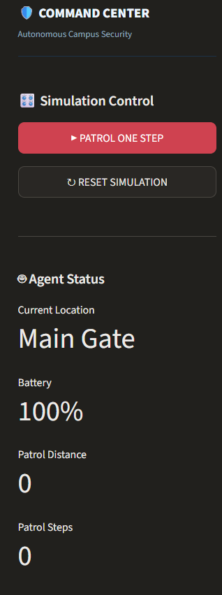
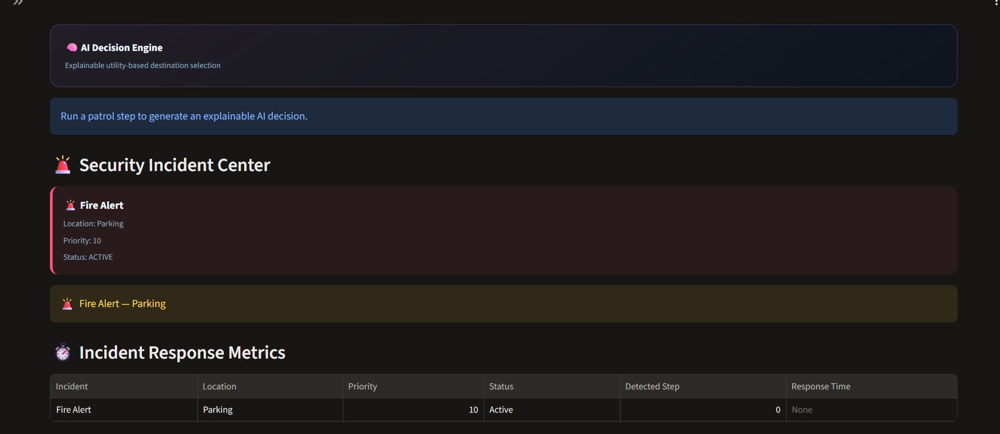
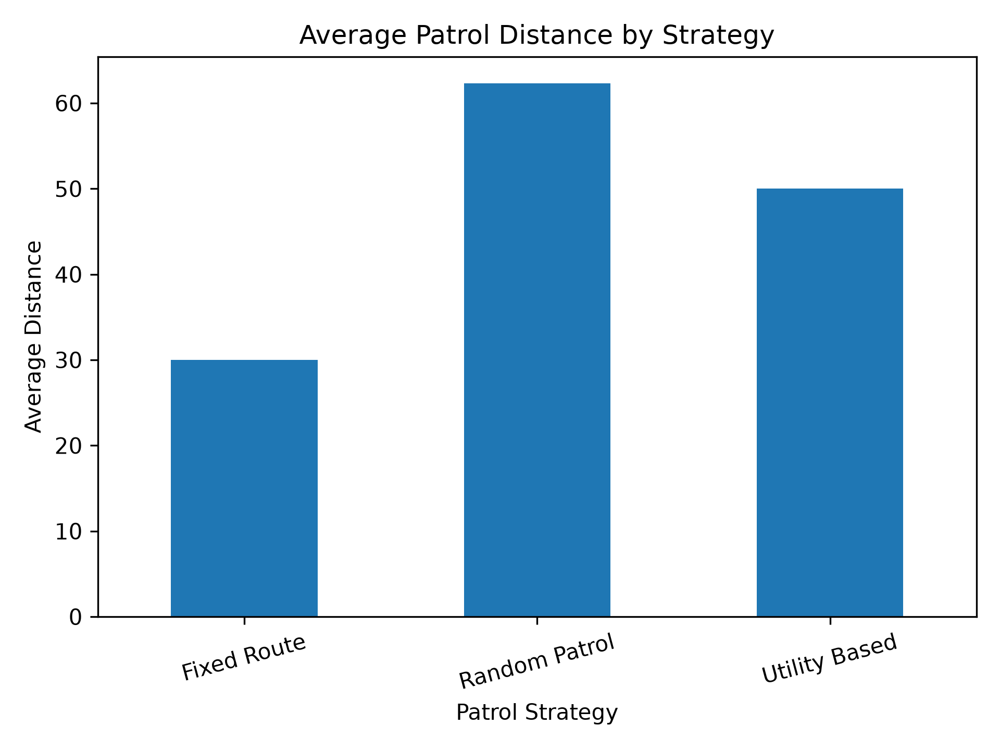
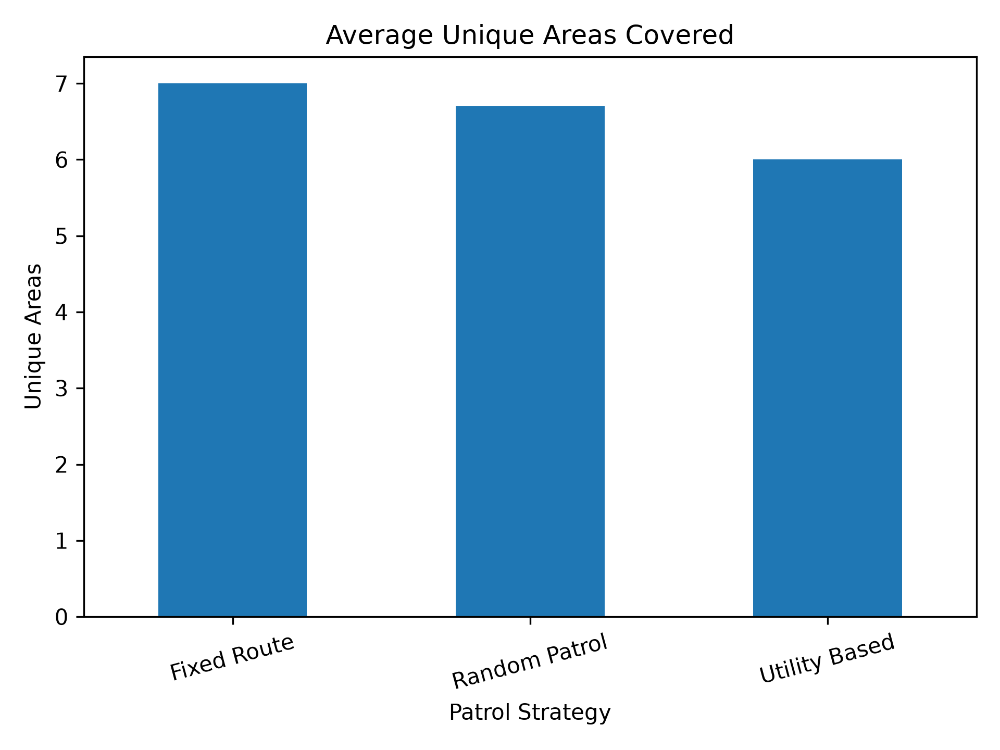
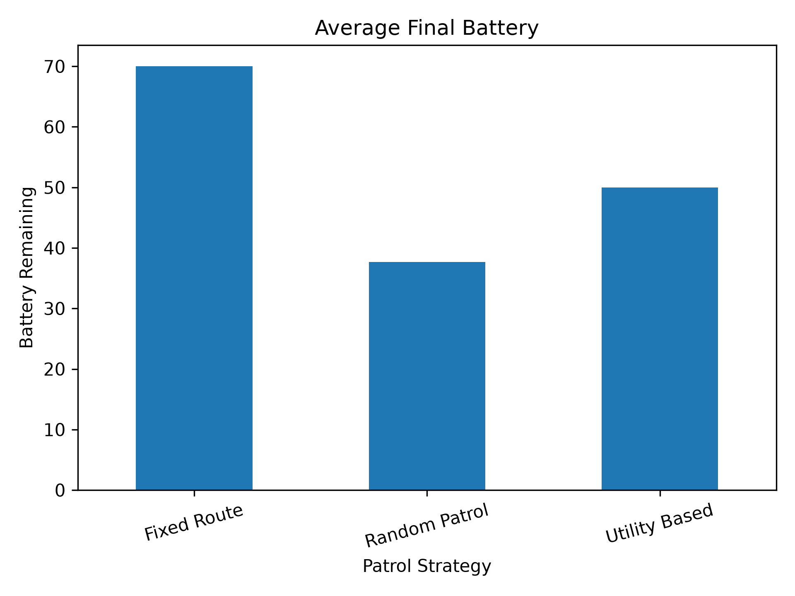

# Autonomous Campus Security Patrol System

An AI-based campus security project that simulates autonomous patrol agents moving around a university campus, monitoring security incidents and managing their battery.

The project compares different patrol strategies and also includes a two-agent system, where two security agents patrol separate campus areas.

**Live Dashboard:** https://autonomous-campus-security.onrender.com/

**GitHub Repository:** https://github.com/kodumurinagasaivignesh/Autonomous_Campus_Security

---

## About the Project

The main idea of this project is to simulate how autonomous agents can be used for campus security.

We created a virtual campus using a graph, where each node represents a location and the edges represent paths between locations.

The agents move around the campus, visit different locations, respond to simulated incidents and manage their battery.

We implemented three different patrol strategies:

- **Random Patrol** – selects the next location randomly.
- **Fixed Route Patrol** – follows a predefined route.
- **Utility-Based Patrol** – selects a location based on risk, coverage, active alerts, travel cost and battery cost.

We also implemented a multi-agent system with two agents starting from different locations.

## Features

- Campus environment with 9 locations.
- Three different patrol strategies.
- Utility-based decision-making.
- Security incident simulation.
- Battery consumption and charging.
- Explainable AI to show why an agent selects a location.
- Two-agent patrol with territory-based coordination.
- Patrol performance evaluation.
- Interactive Streamlit dashboard.
- Automated testing using Pytest.

## Campus Locations

The simulated campus contains these nine locations:

1. Main Gate
2. Academic Block
3. Library
4. Hostel
5. Canteen
6. Parking
7. Sports Ground
8. Administration
9. Security Office

The campus is represented as a weighted graph using NetworkX. Shortest paths are used for agent movement.

## How the Utility-Based Agent Works

The utility-based agent calculates a score for possible destinations and selects the destination with the highest score.

The formula used in our implementation is:

\[
U(d)=0.25R(d)+0.20C(d)+0.40A(d)-0.10T(d)-0.05B(d)
\]

Where:

| Factor | Meaning | Weight |
|---|---|---:|
| R(d) | Security Risk | 0.25 |
| C(d) | Patrol Coverage | 0.20 |
| A(d) | Live Alert Priority | 0.40 |
| T(d) | Travel Cost | 0.10 |
| B(d) | Battery Cost | 0.05 |

Risk, coverage and alerts increase the utility score. Travel cost and battery cost reduce it.

The agent uses these values to decide which location should be visited next.

## Security Incidents

The project supports four types of simulated incidents:

- Unauthorized Entry
- Suspicious Activity
- Fire Alert
- Emergency

The system keeps track of incident locations, priorities, detection steps and resolution steps.

When an incident is active, the utility-based agent considers its priority while selecting the next destination.

## Battery Management

Battery management is included to make the patrol simulation more realistic.

The system handles:

- Battery consumption during movement.
- Low battery conditions.
- Charging station navigation.
- Automatic recharging.
- Prevention of movements when the available battery is insufficient.

## Multi-Agent Patrol

Apart from the single-agent strategies, we implemented a two-agent patrol system.

| Agent | Starting Location |
|---|---|
| Agent 1 | Main Gate |
| Agent 2 | Security Office |

Each agent is assigned a territory and prioritizes locations in that area.

The system records individual coverage, total campus coverage, patrol distance, battery remaining and overlapping locations.

## Dashboard

We developed the dashboard using Streamlit and Plotly.

It helps us monitor the simulation without having to check the Python output every time.

Some of the dashboard features are:

- Current agent location and movement.
- Campus map and patrol path.
- Battery status.
- Active security incidents.
- Utility-based decision explanations.
- Patrol strategy comparison.
- Multi-agent monitoring.

**Dashboard:** https://autonomous-campus-security.onrender.com/

### Screenshots

**Dashboard**



**Campus Map**



**Command Center**



**Incident Center**



**Multi-Agent Command Center**


**Additional Dashboard Views**


## Experimental Results

We evaluated the three patrol strategies using 10 trials, with 10 steps in each trial.

The following table shows the average results.

| Metric | Random Patrol | Fixed Route | Utility-Based |
|---|---:|---:|---:|
| Average Distance | 62.30 | 30.00 | 50.00 |
| Unique Areas Visited | 6.70 | 7.00 | 6.00 |
| Total Visits | 10.00 | 10.00 | 10.00 |
| Final Battery | 37.70 | 70.00 | 50.00 |
| Campus Coverage | 74.44% | 77.78% | 66.67% |

Campus coverage is calculated using:

\[
\text{Coverage}=\frac{\text{Unique Areas Visited}}{9}\times100
\]

### Result Charts

**Average Patrol Distance**



**Unique Areas Visited**



**Final Battery**



### What We Observed

- Fixed Route Patrol performed best in this experiment, with the lowest average distance of 30.00.
- It also visited the highest number of unique areas and retained the most battery.
- Utility-Based Patrol performed better than Random Patrol in average distance and remaining battery.
- Random Patrol visited slightly more unique areas than Utility-Based Patrol.

These results are based on our current campus layout and simulation settings.

### Multi-Agent Results

We also evaluated the two-agent system over 10 trials.

| Metric | Average Result |
|---|---:|
| Total Campus Coverage | 44.44% |
| Agent 1 Territory Coverage | 50.00% |
| Agent 2 Territory Coverage | 40.00% |
| Average Total Distance | 60.00 |
| Average Battery Remaining | 70.00 |
| Average Overlap Count | 0.00 |

The average overlap count was zero in the evaluated trials. Overall campus coverage was 44.44%, so there is still scope to improve the patrol coverage.

## Technologies Used

| Technology | Usage |
|---|---|
| Python | Main programming language |
| NetworkX | Campus graph and shortest paths |
| Streamlit | Web dashboard |
| Plotly | Graphs and visualizations |
| Pandas | Experiment results and data analysis |
| Pytest | Testing |
| Git and GitHub | Version control and repository hosting |
| Render | Dashboard deployment |

## Project Structure

```text
Autonomous_Campus_Security/
│
├── src/
│   ├── environment.py
│   ├── agent.py
│   ├── battery.py
│   ├── incidents.py
│   ├── random_patrol.py
│   ├── fixed_patrol.py
│   ├── utility_agent.py
│   ├── explainability.py
│   └── multi_agent.py
│
├── dashboard/
│   └── app.py
│
├── experiments/
│   ├── evaluate_patrol.py
│   ├── evaluate_multi_agent.py
│   ├── analyze_results.py
│   └── plot_results.py
│
├── results/
│   ├── patrol_results.csv
│   ├── multi_agent_results.csv
│   ├── patrol_summary.csv
│   └── multi_agent_summary.csv
│
├── tests/
│   └── test_project.py
│
├── screenshots/
│
├── docs/
│   └── images/
│
├── requirements.txt
├── README.md
└── .gitignore
```

## Installation and Running

### 1. Clone the repository

```bash
git clone https://github.com/kodumurinagasaivignesh/Autonomous_Campus_Security.git
```

### 2. Open the project folder

```bash
cd Autonomous_Campus_Security
```

### 3. Create a virtual environment

```bash
python -m venv venv
```

### 4. Activate it (Windows PowerShell)

```powershell
venv\Scripts\Activate.ps1
```

### 5. Install the required packages

```bash
pip install -r requirements.txt
```

### 6. Start the dashboard

```bash
streamlit run dashboard/app.py
```

Open the following address in your browser:

```text
http://localhost:8501
```

## Running Experiments

To evaluate the patrol strategies:

```bash
python experiments/evaluate_patrol.py
```

To evaluate the multi-agent system:

```bash
python experiments/evaluate_multi_agent.py
```

To analyze the results:

```bash
python experiments/analyze_results.py
```

To generate the comparison charts:

```bash
python experiments/plot_results.py
```

## Testing

We used Pytest to check the main project components.

Run:

```bash
pytest -q
```

**Latest verified result:**

```text
21 passed
```

## Limitations

A few things to keep in mind about the current implementation:

- The campus is simulated rather than a real campus map.
- Incidents and risk values are predefined.
- Real CCTV cameras and physical sensors are not connected.
- Battery consumption is simplified.
- The agents operate inside the simulation and do not control physical robots.
- Multi-agent communication is simulated.

## Future Improvements

Some features that can be added later:

- Real-time CCTV and sensor integration.
- Computer vision for incident detection.
- Real campus map integration.
- Better multi-agent coordination.
- Reinforcement learning for patrol optimization.
- Real-time notifications.
- Integration with physical patrol robots.

## Team Members

**Group 13 – CSE276**

- Kodumuri Naga Sai Vignesh
- Dhruv Choudhary
- Nandavarapu Mohan Venkat Maniram

**Lovely Professional University**

**Course:** CSE276 – Artificial Intelligence Foundations

**Project:** Autonomous Patrol & Surveillance Agent for Campus Security

**Academic Session:** 2026–27

---

This project was developed as part of our academic work to explore autonomous agents, AI decision-making and multi-agent systems for campus security.
